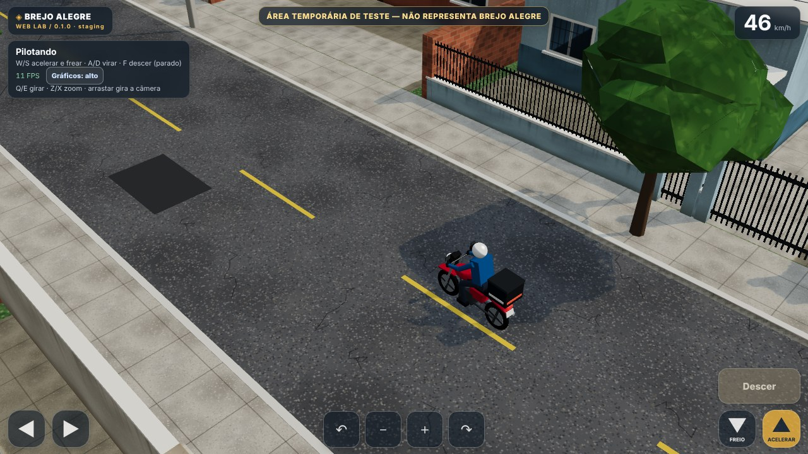

# Brejo Alegre Web Lab — simulador 3D experimental

**Únicas branches vigentes: [`preview`](https://github.com/raff1play/BrejoAlegre-WebLab/tree/preview) e `main`.** **Versão estável:** `main` (consolidação no [PR #6](https://github.com/raff1play/BrejoAlegre-WebLab/pull/6), ainda em revisão; PRs #2–#5 fechados sem merge). **Jogo público:** https://raff1play.github.io/BrejoAlegre-WebLab/

O Web Lab é um protótipo **single-player** no navegador com Babylon.js 9.35.0, TypeScript 5.9.3 e Vite 7.3.0. A versão de jogo definitiva em Godot/Android, com multiplayer e logística, é um projeto futuro distinto. A cidade atual é fictícia, com aviso na tela.



## Estado da experiência

- W009: moto/entregador articulados, analógico, caminhar/montar/desmontar e cenário urbano.
- CORE-010: remasterização de luz, vegetação e fachadas.
- CORE-011: modelos e texturas externos Poly Haven com licença CC0 (veja `public/assets/ASSET_MANIFEST.md`).
- CORE-012: câmera em terceira pessoa estilo GTA, botão **GTA/ISO** para voltar à isométrica e tecla **C**.
- O Easter egg W010–W012 pertence ao histórico de um experimento descartado (PR #1 fechado). A branch experimental foi excluída sem incorporar seus recursos à `preview`. O PWA foi suspenso; usar navegador.
- CI da CORE-012 passou com **56/56 testes unitários** e build staging; os novos cenários E2E de câmera foram adicionados, mas não são executados automaticamente pela CI.
- FPS, ergonomia e câmera no Galaxy S24 exigem validação no aparelho real. Não inferir isso de um navegador headless.

## Fluxo de trabalho

As mudanças normais são commits na `preview` — **não abrimos uma branch/PR para cada ajuste**. A CI valida os commits, mas **não publica automaticamente**. Só quando o usuário autoriza, o arquivo `docs/PREVIEW_DEPLOY_TRIGGER.md` é atualizado e o workflow da `preview` publica no único site GitHub Pages. Para consolidar uma versão estável, fazemos PR de `preview` para `main`, revisamos e só então integramos.

Leia [`AGENTS.md`](AGENTS.md), [`docs/WORKFLOW.md`](docs/WORKFLOW.md) e [`docs/PROJECT_STATE.md`](docs/PROJECT_STATE.md). Não fazer merge ou deploy sem autorização.

## Rodar localmente

Requer Node.js **22.12+**, npm e acesso inicial ao registro de pacotes.

```bash
npm ci
npm run validate:repo
npm run test:unit
npm run typecheck
npm run dev
```

Abra http://localhost:5173. `npm run build:staging` compila o staging e `npm run preview` serve a compilação local; nenhum desses comandos publica online.

## Controles

| Ação | Teclado/mouse | Android (navegador) |
|---|---|---|
| Acelerar/frear na moto | W / S | Botões à direita |
| Virar a moto | A / D | Analógico esquerdo horizontal |
| Caminhar | WASD | Analógico esquerdo 360° |
| Montar/descer parado | F / Enter | Botão Montar/Descer |
| Alternar GTA/isométrica | C | Botão GTA/ISO |
| Girar câmera | Q / E ou arrastar | Botões e arrastar |
| Zoom | Z / X, roda do mouse | Botões ou pinça |
| Perfil gráfico | G | Botão Gráficos |

O jogo mantém dois perfis gráficos. Para forçar um perfil, acrescente `?gfx=mobile` ou `?gfx=desktop` à URL.

## Escopo e licenças

Não há servidor, NPCs logísticos, entregas, economia nem multiplayer neste Web Lab. O mapa real e essas mecânicas pertencem ao plano futuro em `docs/product/ORIGINAL_GODOT_SPEC.md`. Os assets externos instalados têm fonte e licença registradas; não adicionar novos sem comprovação. Sem assinatura adicional para o motor.
