# ART-002 — arquitetura e logística física

Base ART-001 `3931aa2`, continuação na **mesma** branch `feat/art-001-primeira-loja-moto`. Sem merge, outra branch, publicação ou gatilho alterado. Loja e moto da ART-001 preservadas.

## Implantação

Quadra q3 e transformação `depotWorld()` preservadas; lote de 63,6 × 57,8 m e edifício de 44 × 24 m, sem avanço sobre ruas/lotes vizinhos. [Auditoria inicial](audit.md).

- Entrada veicular de 12 m com duas folhas deslizantes, controle junto à portaria e modo automático por aproximação. A colisão acompanha as posições das folhas, inclusive durante abertura parcial. Sensor impede fechamento sobre jogador/moto; portão fechado continua fechado em modo manual.
- Acesso a pé separado, com balizador que permite a passagem do pedestre e restringe a moto, e faixa protegida até o galpão. Guarita com porta e paredes/janelas reais, cercamento contínuo do terreno.
- Quatro vagas de moto de 1,8 × 3,2 m (uma ocupada pela moto estática existente); três vagas futuras de carro de 3 × 5,4 m, sem novo sistema de condução. Pátio de manobra separado da descarga a pé.
- Cobertura industrial em duas águas, tesouras metálicas, pilares, esquadrias, concreto com juntas/remendos e sinalização. Elementos operacionais derivam de `depotFixtures()`; não há caixas de encomendas decorativas.
- Doca 01: acesso a pé. **Doca 02: retirada da ROTA-01.** Docas 03/04: reserva, sem cargas fictícias. **Doca 05: entrada de caminhão** com carga física. As baias de entregadores são ao nível do piso, sem plataforma de 1 m bloqueando a passagem como antes.

```mermaid
flowchart LR
  Rua --> Portaria[Portaria / portão 12 m]
  Portaria --> Patio[Pátio e vagas de descarga]
  Patio --> Bau[Parar / descer / retirar até 4]
  Bau --> Recebimento[Bancada de recebimento]
  Caminhao[Caminhão / doca 05] --> Descarregador[Descarregador 1]
  Descarregador --> Recebimento
  Recebimento --> Conferente[Conferente / ID validado]
  Conferente --> Descarregador2[Descarregador 2 / transferência]
  Descarregador2 --> Esteira[Esteira / separador 1]
  Esteira --> Separador2[Separador 2 / região]
  Separador2 --> Gaiolas[Gaiolas Centro e Brejo Alegre]
  Gaiolas --> Expedidor[Expedidor / mesmos IDs]
  Expedidor --> D02[Doca 02 / ROTA-01 mista ML-SHP]
  D02 --> Retirada[A partir de 15h / uma saca]
  Retirada --> Guardar[Levar à moto / guardar no baú]
  Guardar --> Enderecos[Entregas existentes]
```



## Um sistema de pacotes

`Parcel` continua sendo o inventário único. Foram ampliados `ParcelPlace`/`PLACE_MOVES`, posição contínua no referencial do galpão, custodiante, carga/doca atribuídas e eventos com posição/responsável. `move()` agora atualiza também `holder`; a versão anterior registrava `by` sem corrigir a custódia.

Fluxo da loja: `loja → maos → bau → maos → recebimento → conferencia → transferencia → triagem → transferencia → gaiola → transferencia → doca → saca → maos → bau → maos → destinatario`.

Fluxo do caminhão: começa em `caminhao`, registra chegada na doca 05, é retirado pelo descarregador em `transferencia` e entra no mesmo `recebimento` acima. Os IDs ML/SHP criados no início não são substituídos.

- Descarregar exige moto parada numa vaga válida, jogador a pé junto ao baú e capacidade livre nas mãos. Depositar exige chegar ao recebimento; não funciona do outro lado do pátio ou com o veículo em movimento.
- `DepotOperations` reserva cada ID para uma tarefa por vez. Aproximação, pega, caminhada, deposição e processamento são fases determinísticas. A esteira só move encomendas efetivamente encaminhadas a ela. Estado só avança no término bem-sucedido da operação correspondente; input invalidado aborta a tarefa sem avançá-lo.
- NPCs seguem as posições do controlador. Não há rotas alternadas por cronômetro nem caixa fictícia nas mãos dos funcionários. Oito papéis preservados: seis operacionais mais porteiro e supervisor.
- Rotas em grade de 0,5 m verificam sólidos e conexões aos pontos exatos. As transferências interpolam a mesma posição do pacote; o renderer não escreve estados.
- A posição de uma carga na doca só some da cena quando `takeSack()` efetiva a transferência. A saca única contém os mesmos registros, inclusive plataformas mistas. `dock`/`load` persistem como atribuição histórica durante a rota; a localização atual é `place`/`position`.
- Caixas no galpão usam instâncias e etiquetas em um atlas compartilhado, com relação de IDs disponível no snapshot. Nas mãos são até quatro volumes visuais; a saca é um agrupamento único com contagem explícita e IDs individuais. No baú continua o agrupamento/carga da mecânica existente.

## Evidências e método

| Cena | Antes | Depois |
|---|---|---|
| Entrada/portaria | [antes](before/entrada.jpg) | [depois](after/entrada.jpg) |
| Pátio | [antes](before/patio.jpg) | [depois](after/patio.jpg) |
| Estrutura do galpão | [antes](before/galpao.jpg) | [depois](after/galpao.jpg) |
| Triagem | [antes](before/triagem.jpg) | [depois](after/triagem.jpg) |
| Docas | [antes](before/docas.jpg) | [depois](after/docas.jpg) |

Capturas reais do Babylon/Chromium, sem imagem gerada por IA ou retoque, em 1280×720, perfil desktop, tráfego desligado, hora inicial 12h30. Câmera de inspeção sem céu/névoa, poses idênticas salvas nos JSONs. As imagens de implantação mostram a instalação sem carga inicial; a operação real aparece em `operation/`.

O enquadramento de triagem foi corrigido **nos dois lados** para ficar dentro do edifício, pois a primeira câmera estava diante da parede frontal. Para refazer o antes sem mudar branches foi extraído `git archive 3931aa2` em `/tmp/art002-baseline`, servidor separado na porta 5174 e cache Vite separado. Não é outro jogo nem branch; é a base intacta para comparação. O cache de compilação é a única configuração local ajustada nessa cópia.

```sh
npm run dev -- --port 5173
node scripts/art002/capture.cjs docs/evidence/art-002/after
# para a base arquivada, com servidor na porta 5174:
WEBLAB_URL=http://localhost:5174 node scripts/art002/capture.cjs docs/evidence/art-002/before
node scripts/art002/acceptance.cjs  # inclui caminhadas reais, lento em SwiftShader
ART_FAST=1 node scripts/art002/acceptance.cjs  # replay operacional por fixtures
```

O cenário de aceitação parcial usa `?depotTest=partial` **somente em development**: duas lojas com três volumes cada, mais quatro do caminhão. Os pacotes são criados pelo próprio `Workday.start()`, não inseridos no meio da operação. O jogo normal mantém 2 + 2 + 4 = 8 volumes.

Para atravessar a cidade, o teste usa os fixtures de teleporte da infraestrutura existente. No galpão, aceleração contra portão, entrada, parada e desmontagem usam os controles e colisões reais. A série `physical-walk.txt` também percorre a pé as duas viagens completas; essa execução foi interrompida por um problema de serialização do roteiro ao começar o processamento. A execução completa `operation.txt` foi repetida com `ART_FAST=1`: as caminhadas são por fixtures, e a operação/custódia usa a simulação real. Os arquivos são provas separadas; não representam uma única gravação contínua. O processamento no headless pode executar passos limitados com `processDepot()`, renderizando os resultados entre passos; o helper não edita encomendas nem força estados. Isso é teste determinístico de navegador, não uma medição de tempo de serviço em aparelho físico.

## Limitações e avaliação

A transformação estrutural e operacional é significativa: há separação de fluxos, áreas utilizáveis e transferência contínua de volumes reais, em vez de uma cena com caixas decorativas e estados por relógio. O acabamento ainda é estilizado e simplificado; não equivale a uma instalação fotografada ou a assets industriais profissionais.

O caminhão de fornecedor é uma representação local estacionada na doca 05 no horário de chegada (fallback das 13h), não uma nova IA de caminhão navegando até o pátio. Não foi reescrito o tráfego global. Colisores de mesas, gaiolas e veículos são volumes simplificados conservadores, derivados da geometria; não há navegação por baixo de mesas ou dentro de gaiolas.

Porteiro e supervisor são papéis estacionários associados a acesso/supervisão; não executam uma coreografia decorativa. A fila é para uma carga/entregador local, sem múltiplos entregadores simultâneos. Grandes capacidades de armazém, empilhadeiras e múltiplas rotas paralelas não foram implementadas.

Android físico, temperatura, bateria, ergonomia real e 30 FPS no aparelho **não foram testados**. A comparação de cena registra geometria e draw calls em SwiftShader; não promete fluidez em GPU física. A referência visual exata não foi anexada nesta sessão; avaliação feita contra a descrição do usuário.

## Verificação e arquivos

- `npm run check`: validação, **110/110 testes unitários**, TypeScript strict e build de staging aprovados. Log final: [check.txt](check.txt). O Vite ainda avisa sobre o bundle principal acima de 1.500 kB.
- Core: três lojas/seis volumes coletados mais quatro do caminhão; descarga 4 + 2; rejeição fora da área/em movimento/sem doca pronta; histórico sem saltos, IDs conservados até a entrega, saca mista ML/SHP e salto do relógio sem concluir tarefas. Rotas e colisões testadas contra a planta compartilhada.
- Navegador operacional: [operation.txt](operation.txt), [JSON com todos os IDs e históricos](operation/trace.json), [ciclo BA-0001](parcel-cycle.md). Duas lojas, descarga parcial, fila física, caminhão, doca correta e **10/10 entregas**, sem erros de navegador ou tarefas.
- Caminhada por controles reais nas duas viagens: [physical-walk.txt](physical-walk.txt). No percurso inicial foi corrigida a conexão da grade junto à moto estacionada; timeouts do roteiro em GPU por software foram ampliados.
- Consistência visual final: [visual-smoke.txt](visual-smoke.txt) prova quatro volumes nas mãos e, no mesmo quadro após o depósito, zero nas mãos e quatro IDs no galpão. A pose é interpolada, mas a visibilidade acompanha imediatamente a custódia.
- Resize nativo **900×420** aprovado: [resize-native.txt](resize-native.txt). A primeira execução completa em resolução reduzida foi 83/84: somente resize falhou por escala forçada 4. O adaptador foi corrigido para restaurar a função nativa de resolução no caso de resize; o log inicial foi preservado como [e2e-initial-scaled.txt](e2e-initial-scaled.txt).
- Comparação estática de cinco cenas em resolução nativa: [performance.md](performance.md), dados em `before/metrics.json` e `after/metrics.json`.

Código principal: `src/world/city/depotPlan.ts`, `depotArchitecture.ts`, integração em `cityPlan.ts`/`cityBuild.ts`/`cityLayout.ts`, substituição dos props antigos em `depotDetail.ts`; `src/core/delivery/{parcels,depotOperations,workday}.ts`; `src/features/delivery/{deliveryGame,depotParcels}.ts`; sincronização em `npcPerson.ts`, `pedestrian.ts` e `src/main.ts`. Testes: `depot.test.ts`, `depotFlow.test.ts`, `parcelCustody.test.ts`, migração da jornada em `delivery.test.ts`, `geo.test.ts` e `tests/e2e/play.cjs`. Scripts reproduzíveis em `scripts/art002/`.

A equipe operacional foi mantida disponível até o encerramento às 21h para não exibir volumes se movendo sem seu funcionário depois das 19h. A iluminação industrial usa luminárias emissivas, sem luz dinâmica individual em cada peça. O acabamento e a validação física em Android continuam como limites.

Resultado final da repetição completa: **84/84 verificações passaram**, incluindo resize nativo dentro do próprio roteiro. Log: [e2e.txt](e2e.txt). A jornada normal terminou com **8/8 IDs entregues**; a fixture operacional ampliada terminou com **10/10**, incluindo a descarga 4 + 2. O adaptador reduzido existe apenas nos scripts de teste; os comparativos de arte não usam escala reduzida.

A revisão final também confirmou o corpo e a plataforma traseira do caminhão como obstáculos nas suas posições visíveis, deixando o espaço adjacente livre: [truck-collision.txt](truck-collision.txt). Foram feitos os ajustes finais de sincronização de mãos, contenção frontal das gaiolas e orientação do descarregador; o build e os 110 testes passaram após esses ajustes. Os gestos de manipulação são simplificados, sem simulação física de agarrar cada caixa nem precisão de dedos.

Commits por etapa:

- `c9b3f0a` — ART-002A: implantação arquitetônica.
- `46b63af` — ART-002B: colisões e acessibilidade.
- `74aae29` — ART-002C: identidade, posição e custódia do recebimento.
- `c9967b1` — ART-002D: controlador de tarefas, conferência, triagem e doca.
- `df5ba23` — ART-002E: NPCs, instâncias/etiquetas, interações e integração.
- ART-002F: commit final desta entrega, com refinamentos, regressões, scripts e evidências; SHA no histórico da branch.

Manifesto completo dos arquivos da alteração: [files.txt](files.txt). Próximo passo: revisão humana do fluxo e teste físico no aparelho. Nenhum aceite visual ou resultado de 30 FPS é presumido.
